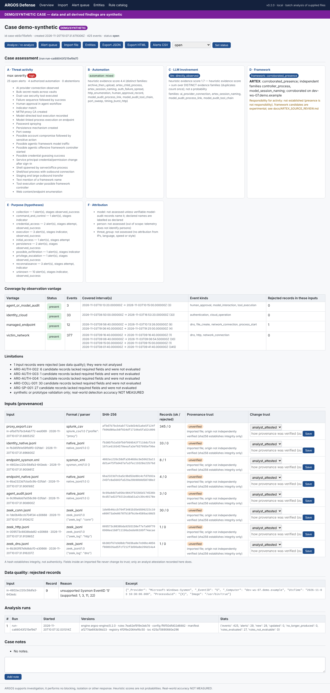
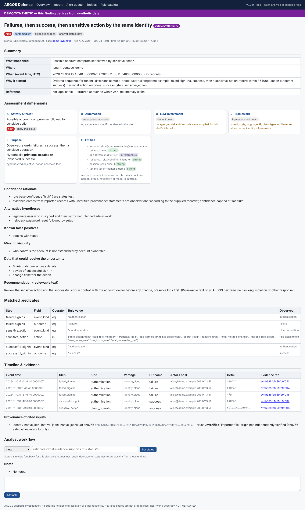

# ARGOS Defense

**Local defensive investigation framework for explainable analysis of suspicious, automated, and LLM-assisted activity.**

> **Experimental detection; real-world accuracy not measured.** All validation so far uses synthetic data.

[Español: README.es.md](README.es.md) · [Changelog](CHANGELOG.md) · [Security](SECURITY.md) · [Contributing](CONTRIBUTING.md)

ARGOS Defense imports telemetry files you supply (proxy, identity, endpoint, network and AI-agent audit logs), correlates them per case, runs declarative detection rules and explains **what the evidence supports and what it does not**. It is built for a question that agentic offensive tools such as ARTEX make urgent: *is this activity automated, is an LLM involved, is a known framework present, what is the actor after, and which accounts, hosts and processes are involved?* ARGOS keeps those questions separate and answers *unknown* when the data cannot tell.

It is batch analysis on your own machine: not a real-time sensor, EDR agent or SIEM connector. It performs no blocking, isolation, scanning or other response. No data leaves the machine by default.



## Download

**v0.2.0** — [Release page](https://github.com/CSTHUESP/argos-defense/releases/tag/v0.2.0). The repository is private: downloads require a GitHub account with access to it.

| Your system | Download | Built and smoke-tested on |
|---|---|---|
| Windows 10/11 or Server, 64-bit Intel/AMD | [ARGOS-Defense-0.2.0-windows-x86_64.zip](https://github.com/CSTHUESP/argos-defense/releases/download/v0.2.0/ARGOS-Defense-0.2.0-windows-x86_64.zip) | GitHub runner `windows-2022` |
| Linux, 64-bit Intel/AMD (glibc ≥ 2.35) | [ARGOS-Defense-0.2.0-linux-x86_64.tar.gz](https://github.com/CSTHUESP/argos-defense/releases/download/v0.2.0/ARGOS-Defense-0.2.0-linux-x86_64.tar.gz) | GitHub runner `ubuntu-22.04` |
| Mac with Apple Silicon (M1/M2/M3/M4) | [ARGOS-Defense-0.2.0-macos-arm64.zip](https://github.com/CSTHUESP/argos-defense/releases/download/v0.2.0/ARGOS-Defense-0.2.0-macos-arm64.zip) | GitHub runner `macos-15` (arm64) |
| Mac with Intel processor | [ARGOS-Defense-0.2.0-macos-x86_64.zip](https://github.com/CSTHUESP/argos-defense/releases/download/v0.2.0/ARGOS-Defense-0.2.0-macos-x86_64.zip) | GitHub runner `macos-15-intel` |
| Any OS with Python 3.11+ | [wheel](https://github.com/CSTHUESP/argos-defense/releases/download/v0.2.0/argos_defense-0.2.0-py3-none-any.whl) · [sdist](https://github.com/CSTHUESP/argos-defense/releases/download/v0.2.0/argos_defense-0.2.0.tar.gz) | CI on Ubuntu, Windows, macOS |

Also published: `SHA256SUMS`, `release-manifest.json` (commit, build environment, smoke results, signing status), per-platform CycloneDX SBOMs, and the native smoke-test results/logs. Verify a download with `sha256sum -c SHA256SUMS --ignore-missing` (Linux), `shasum -a 256 <file>` (macOS) or `Get-FileHash <file> -Algorithm SHA256` (PowerShell).

The packages contain everything they need. No Python installation is required, and the core works offline.

**Tested baselines:** the native packages were tested only on the GitHub-hosted runner images named above. They were not tested on Windows 10/11 desktop editions, other Linux distributions, or other macOS versions; those are expected to work if they meet the requirements, but that is not verified.

## Start

| | Steps |
|---|---|
| **Windows** | Extract the ZIP → double-click **`Start ARGOS Defense.cmd`**. SmartScreen may warn because the executable is not code-signed. Check the file hash against `SHA256SUMS`, then choose *More info → Run anyway* if you decide to trust it. |
| **macOS** | Double-click the ZIP to extract it → double-click **`Start ARGOS Defense.command`**. The build is not notarized, so Gatekeeper may block the first launch. Open *System Settings → Privacy & Security* and click *Open Anyway* (Apple's documented procedure), then launch again. |
| **Linux** | `tar xzf ARGOS-Defense-0.2.0-linux-x86_64.tar.gz && ./ARGOS-Defense-0.2.0-linux-x86_64/start-argos-defense.sh` |

The launcher starts the local server on `http://127.0.0.1:8789` (loopback only) and opens your browser already logged in. Stop it with **Ctrl+C**, or by closing the terminal window.

Options (the same executable is under `argos-defense/`): `start --no-browser` prints the token-file location instead of opening a browser; `--port 0` picks a free port; `--data-dir <folder>` chooses where data lives. If the port is in use, ARGOS says so and exits.

### Authenticate
The session token is a random secret stored in `<data dir>/.session_token`. The launcher passes it to your browser. With `--no-browser`, open `http://127.0.0.1:<port>/login` and paste the token from that file. It is never printed unless you use `--show-token`.

## Try the demo (no private data, no API keys)
In a terminal inside the extracted folder:

```
argos-defense/argos-defense demo          # Windows: argos-defense\argos-defense.exe demo
```
Then start the UI. The **demo-synthetic** case (purple *DEMO/SYNTHETIC* banner) contains generated proxy, identity, Sysmon, Zeek, EDR and agent-audit data with RFC 5737 addresses. It covers an authorized scanner, a password spray, a slow account takeover, a web shell, a service-principal credential addition, an archive-and-upload, and a developer workstation running an LLM agent.

## Investigate your own data
1. **Import:** *Import* page → choose the case, adapter, mapping profile (for Splunk) and file. The result lists accepted and rejected records with the actual reasons. CLI: `argos-defense ingest FILE --format FORMAT --case CASE`.
2. **Analyze:** case page → *Analyze / re-analyze* (CLI: `argos-defense analyze --case CASE`). Re-analysis is idempotent and keeps notes and history.
3. **Investigate:** *Alert queue* with filters for severity, confidence, activity, automation, LLM and framework → alert page showing the six dimensions, matched predicates, timeline, evidence references (each opens the normalized record and the original line), alternative hypotheses, missing visibility, and data that would resolve the uncertainty. Add notes and set status. *Entities* shows accounts, devices, processes, sessions and IPs, keeping observed relationships separate from inferred ones.
4. **Export:** *Export JSON / Export HTML / Alerts CSV* (CLI: `argos-defense report --case CASE --format html`). Exports include the timeline, evidence references, versions and configuration. Secrets are redacted and spreadsheet formulas neutralized.



## The six evidence dimensions
| Dimension | Values | What it takes |
|---|---|---|
| A · Threat activity | severity + informational / suspicious / likely malicious | observed actions; independent of whether a human or an LLM acted (slow attacks still alert) |
| B · Automation | unknown · consistent with automation · observed automation · observed manual component · mixed | timing alone gives only "consistent"; agent audit records or the authorized-automation registry give "observed"; human-approval records give a manual component |
| C · LLM involvement | unknown · possible · directly observed | a connection to an AI provider gives "possible" only; "directly observed" needs model-audit records linked to an execution (same session or ProcessGuid). Missing AI evidence never means "human". Victim-side traffic cannot see an attacker's model calls |
| D · Framework | unknown · consistent with · corroborated presence | experimental fingerprints; presence needs two independent artifacts on one host; execution and responsibility for an incident are never inferred |
| E · Purpose | observed action + hypothesis + stage (indicator / attempt / observed success) | a hypothesis, not a fact; volume or a successful sign-in is not proof of data theft |
| F · Entities | accounts, service principals, devices, processes, sessions, tenants, IPs, domains | strong vs weak keys; a shared IP never merges accounts; who owns an account is not who controls it |

Confidence (insufficient / low / medium / high) is separate from severity and capped by documented rules. Experimental rules are capped at low, and imported files with unverified provenance at medium. Heuristic evidence scores count each distinct evidence family once and are **not probabilities**. ARGOS never names a person, nationality, threat group or exact model.

## ARGOS and ARTEX
- **Architectural inspiration:** ARGOS adapts ideas from ARTEX (BaaRai/ARTEX v0.6.0, commit `a13c68cb…`), an open-source LLM-driven offensive framework: task/intent orchestration, an evidence graph, observed-versus-inferred facts, LLM call recording and human-approval records. All of them are re-implemented independently for defence ([docs/INSPIRATION_MAP.md](docs/INSPIRATION_MAP.md)).
- **Experimental fingerprints:** a static source review found four candidate observables, all visible only on a machine *running* ARTEX or at a model gateway on its outbound path. **No validated victim-side fingerprint was found in the reviewed version** ([docs/ARTEX_SOURCE_REVIEW.md](docs/ARTEX_SOURCE_REVIEW.md)).
- **Reused code: none.** ARTEX (AGPL-3.0) is not bundled, imported or executed. A pinned manifest and `scripts/fetch_artex_reference.sh` retrieve the exact reviewed source for research.

## Supported inputs
| Adapter | Format | What it has been tested against |
|---|---|---|
| `native_jsonl` | ARGOS JSONL schema: HTTP, DNS, connections, processes, files, authentication, cloud operations, model interactions, tool executions, human approvals | synthetic fixtures |
| `splunk_json` | Splunk JSON/JSONL exports, including `result` wrappers and metadata lines; profiles `proxy`, `auth`, `native` or a custom mapping | schema-shaped fixtures built from documented field names |
| `splunk_csv` | Splunk CSV with an **explicit** mapping (BOM, quoted newlines) | schema-shaped fixtures |
| `sysmon_xml` | Sysmon events 1/3/11/22 exported to XML, with or without a root element or namespace | schema-shaped fixtures |
| `zeek_jsonl` | Zeek JSON conn/http/dns logs (epoch or ISO `ts`, `uid` kept); TSV is rejected | schema-shaped fixtures |

No genuine vendor or organizational exports have been tested. EVTX, PCAP and live connectors are not supported. Field reference and byte-direction rules: [docs/DETECTION_MODEL.md](docs/DETECTION_MODEL.md).

## Data, privacy, updates, backups, uninstall
- **Data location:** Windows `%LOCALAPPDATA%\ARGOS Defense`, macOS `~/Library/Application Support/ARGOS Defense`, Linux `~/.local/share/argos-defense` (or `$XDG_DATA_HOME`), or `--data-dir` / `ARGOS_HOME`. Inside: `argos.sqlite3`, `cases/` (read-only copies of imported files), `config/` (editable registry and rule overrides), `reports/`, `logs/`, `.session_token`. Nothing is written inside the application folder.
- **Privacy/offline:** no telemetry, no external calls. The optional LLM explainer is disabled by default and refuses remote endpoints unless explicitly allowed.
- **Update:** extract the new version next to the old one and start it; your data directory is reused. Databases from 0.1.0 are migrated automatically, and a `.v1-backup.sqlite3` copy is kept.
- **Backup:** stop ARGOS and copy the data directory.
- **Uninstall:** delete the extracted folder; delete the data directory to remove all data.

## Install from source (contributors)
```bash
git clone https://github.com/CSTHUESP/argos-defense && cd argos-defense
python3 -m venv .venv && source .venv/bin/activate        # Windows: .venv\Scripts\Activate.ps1
pip install -r requirements.lock -r requirements-dev.lock && pip install --no-deps -e .
argos-defense doctor && argos-defense demo && argos-defense start
python -m pytest                       # full suite
python scripts/validate.py             # synthetic demo scenarios
python scripts/auth_eval.py            # labeled auth-rule evaluation
```
Native packaging: [docs/PACKAGING.md](docs/PACKAGING.md). Rule export to Sigma/SPL: `argos-defense export-rules --output DIR` ([docs/RULE_EXPORTS.md](docs/RULE_EXPORTS.md)).

## Architecture
```
files ─► adapters (native/Splunk/Sysmon/Zeek) ─► normalization + provenance (sha256, record no., vantage, tz)
      ─► SQLite case store ─► entities/relationships ─► YAML rules (each/threshold/sequence/baseline)
      ─► evaluator (confidence caps, registry, IOC validity, absence/source-history checks, missing visibility)
      ─► alerts + case assessment (6 dimensions) ─► Starlette UI / JSON API ─► JSON/HTML/CSV export
```

## Signing and integrity
| | Status |
|---|---|
| Windows Authenticode | **not signed** (no certificate configured) |
| Apple Developer ID / notarization | **not signed / not notarized** (ad-hoc signature only) |
| GitHub artifact attestations | **not generated** (unavailable for private repositories outside GitHub Enterprise Cloud) |
| Checksums | `SHA256SUMS` + `release-manifest.json`: integrity only, not proof of who published the files |

## Capability status (v0.2.0)
| Capability | Status |
|---|---|
| Import/normalize native, Splunk JSON/CSV, Sysmon XML, Zeek JSON | IMPLEMENTED_AND_TESTED (synthetic / schema-shaped data) |
| 27 rules, six-dimension assessment, registry, IOC validity, baselines | IMPLEMENTED_AND_TESTED (synthetic) |
| Web UI, auth/CSRF, notes/status, exports | IMPLEMENTED_AND_TESTED |
| Native packages Windows x64 / Linux x64 / macOS arm64 / macOS x64 | IMPLEMENTED_AND_TESTED on the CI runner images listed above |
| Sigma / SPL export (faithful subset) | IMPLEMENTED_AND_TESTED for syntax/structure; NOT executed in Splunk or a Sigma backend |
| Optional Ollama explainer | IMPLEMENTED_NOT_VERIFIED with a real model (tested against a simulated endpoint) |
| Genuine vendor exports, Windows/macOS desktop editions | NOT VERIFIED |
| EVTX, PCAP, live EDR/SIEM connectors, automatic containment, universal human-vs-LLM classifier | NOT_IMPLEMENTED (out of scope) |
| Real-world detection accuracy | NOT MEASURED |

Validation details: [docs/RELEASE_VALIDATION.md](docs/RELEASE_VALIDATION.md), [docs/VALIDATION.md](docs/VALIDATION.md), [docs/AUTH_RULE_EVALUATION.md](docs/AUTH_RULE_EVALUATION.md). Threat model: [docs/THREAT_MODEL.md](docs/THREAT_MODEL.md).

## Known limitations
Synthetic validation only. The authentication rules still alert at low confidence on repeated typos from a user's own device, and they miss an attacker who both rotates source addresses and interleaves with the real user's sign-ins. Analysis is in-memory per case (tested with 12,000 events). Secret redaction is pattern-based. There is a single local user, and a loopback UI without TLS.

## License
ARGOS Defense: Apache-2.0 ([LICENSE](LICENSE); basis in [docs/LICENSING.md](docs/LICENSING.md)). Third-party components keep their own licenses ([THIRD_PARTY_NOTICES.md](THIRD_PARTY_NOTICES.md)). ARTEX (AGPL-3.0) is not distributed.
